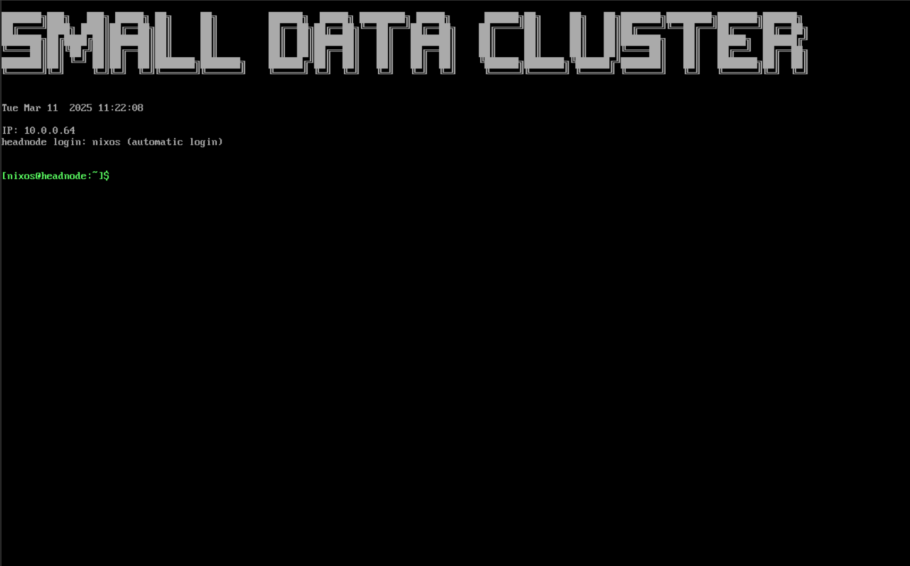

## Отказ от отговорност

- ⚠️ Проектът е в активна разработка.
- ⚠️ Очаквайте бъгове и прекъсвания в съвместимостта.
- ⚠️ Направете резервно копие на вашия код и данни.

## Описание

Динамичен клъстер по заявка за малки и средни предприятия върху
търговски наличен хардуер.

## Мотивация

Анализът на данни може да подобри съществуващите процеси и дейности, например
в качеството на контрол. Въпреки това, според нашия опит при малки и средни
предприятия (МСП), високите инвестиционни разходи и опасенията за сигурността
на данните често възпрепятстват прилагането на Data Science към конкретни
случаи на употреба.

Целта на този проект е да намали инвестиционните разходи за клъстерна
инфраструктура, тъй като това би могло да стимулира изследването на решения
в областта на data science и машинното обучение от страна на МСП.

## Подход

Подходът на този проект е да се построи възпроизводим и мащабируем Plug & Play
Live-ISO с минимални изисквания за конфигурация, който стартира многофункционален
клъстер върху съществуваща инфраструктура в МСП и предоставя добре познати
инструменти и рамки, които позволяват на потребителите да разработват и
обучават модели за машинно обучение. Така МСП могат да използват например
машините на разработчиците извън работното време, за да обучават модели, без
да им е необходим специален хардуер или облачни решения. Това намалява общите
разходи и допринася за сигурността на данните и защитата на интелектуалната
собственост.

## Първи стъпки

Този проект е проектиран като Plug & Play. Тъй като се разгръща чрез Live-ISO,
той не засяга операционните системи, инсталирани на съществуващия хардуер.

Това решение има недостатък, че данните не могат да бъдат запазвани между
рестартирания. Това означава, че всички промени, които правите, и всеки файл,
който създавате, се изтриват при рестарт.

Ако се нуждаете от постоянство на данните, имате възможност да отделите целия
disk за headnode. За това вижте секцията [disko](#disko). В текущия етап на
развитие се насърчава използването на външна система за съхранение.

Коя версия трябва да изберете зависи от вашите изисквания.

Като бърз преглед, с следващите стъпки ще можете да стартирате собствен
клъстер на собствен хардуер.

Създаване локално:

1. Инсталирайте Nix package manager
2. Настройте config.toml според вашите нужди
3. Стартирайте `./build-batch.sh`
4. Запишете ISO образите (в директория ./results) на стартиращ носител,
   ги включете и заредете от тях.

### Конфигуриране на вашия клъстер

Единственият файл, който трябва да настроите, за да стартирате свой собствен
клъстер, е [config.toml](/config.toml). Файлът, предоставен от този repo, служи
като пример и може да бъде адаптиран според вашите нужди.

#### Tailscale

Този проект използва tailscale, за да позволи на възлите да комуникират помежду
си. Въведете вашия tailscale authentication-key (за достъп до вашия tailnet),
API-key (за управление на tailnet) и вашия tailscale domain в конфигурационния
файл.

#### Потребители

Можете да създавате потребители, като ги добавите към [config.toml](/config.toml).
Те изискват потребителско име, hash на паролата и UUID. Тези потребители ще
могат да влизат в jupyter hub и ще имат Linux потребители с тези идентификационни
данни.

По този начин генерирате хешовете на паролите:

```bash
mkpasswd -m sha-512
```

### Live-ISO

Live-ISO е идеален за тестване на стартиране на клъстер на вашия съществуващ
хардуер. Той не запазва данни между сесиите. Тъй като всичко се съхранява в RAM,
не се запазва. Ако искате да запазвате данни между рестартирания, вижте секцията
[disko](#disko) след стартиране на Live-ISO на headnode.

#### Създаване на ISO

Този repository не предоставя предварително построени ISO изображения. Ще трябва
да ги изградите сами. В момента поддържаме изграждане на ISO образи чрез GitLab
и GitHub CI/CD pipeline-и или локално на вашата система.

##### Локално

За да изградите ISO образи локално, трябва да инсталирате
[nix](https://nixos.org/download/) на вашата система.

След това можете да изградите ISO за headnode, като стартирате `nix build .#head`,
и ISO за worker, като стартирате `nix build .#worker`. Получените ISO образи
могат да бъдат намерени под `result/iso/`.

#### Записване на ISO образите на USB устройства

След това трябва да запишете ISO образите на отделни стартиращи носители (напр.
USB sticks). Заменете `ID_OF_YOUR_BOOT_DEVICE_1` и `ID_OF_YOUR_BOOT_DEVICE_2` с
реалния идентификатор на устройството, на което искате да запишете ISO образа.

```bash
ISO=headnode.iso
# записване на ISO
sudo dd if=result/iso/$ISO of=/dev/disk/by-id/ID_OF_YOUR_BOOT_DEVICE_1 status=progress && sync

ISO=workernode.iso
sudo dd if=result/iso/$ISO of=/dev/disk/by-id/ID_OF_YOUR_BOOT_DEVICE_2 status=progress && sync
```

#### Plug & Play

Сега можете да включите стартиращото устройство в съществуващия си хардуер,
да изберете ги през boot menu и да изчакате клъстера да се стартира.

#### disko

Live-ISO за headnode предоставя скрипт, който превръща Live-ISO в пълна
инсталация на NixOS. Той също така разделя диска на bootloader, NixOS и data
partition. Това осигурява persistance на данните. Можете да използвате получения
disk на всякакъв хардуер, но вместо да държите данни само в RAM, сега те се
запазват в data partition. С други думи, можете да вземете данните си със себе
си. Това все още не засяга операционните системи на съществуващия ви хардуер,
но вече вашето разгръщане не е stateless.

Обърнете внимание, че можете да инсталирате това на същия диск, който използвате
за стартиране на Live-ISO на headnode. Не се изискват множество дискове.

## Разработка

Този проект предоставя developer shell. Можете да влезете в него с `nix develop`
или чрез direnv.

## Изисквания

- ISO образите за headnode и workernode трябва да бъдат изградени на същия компютър.
  Това е така, защото на /nix/store/

## Изследователски проект

Това е изследователски проект. Затова се интересуваме от събиране на основни,
анонимни данни за употреба, за да измерим интереса към проекта.

Пример за данни, които периодично изпращаме от всеки разгрънат клъстер към нашия
backend:

```json
{
  "type": "de.fh-aachen.bigdata.hpc-on-demand-telemetry",
  "cluster": "1745849932",
  "nodes": [
    {
      "cores": 2,
      "cpu_load": 27,
      "free_mem": 7527,
      "cpus": 2,
      "sockets": 1,
      "last_busy": 1745849940,
      "hostname": "headnode",
      "real_memory": 11679,
      "alloc_memory": 0,
      "alloc_cpus": 0,
      "alloc_idle_cpus": 2,
      "slurmd_start_time": 1745849940,
      "tres": "cpu=2,mem=11679M,billing=2",
      "version": "23.11.10",
      "state": ["IDLE", "DYNAMIC_NORM"],
      "reason": "",
      "reason_set_by_user": "root",
      "reason_changed_at": {
        "set": true,
        "infinite": false,
        "number": 0
      }
    }
  ]
}
```

Не събираме никакви други данни.

Телеметрията може да бъде изключена, като се зададе `telemetry = false` в
config.toml или във файла със секрети.

## Публикации

- ISC HPC 2025,
  [HPC On-Demand: Dynamic On-Demand Cluster - Computing For SMEs on COTS Computers](./docs/poster_isc.pdf)

## Благодарности

Изразяваме благодарност към Федералното министерство на образованието и
науката (BMBF) за грант номер 02L19C602 (проект WIRKsam)
